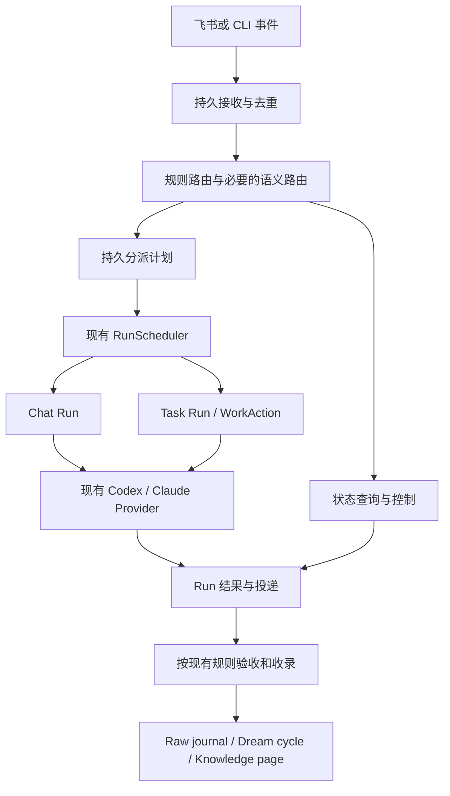

# HomeAgent 多事项协调技术方案

日期：2026-11-03（Asia/Shanghai）

状态：第一期代码已落地，本轮离线验证已完成；Windows 全量未全绿，支持平台恢复、真实飞书和发布验收尚未通过。实际实现与验证记录见第 17 节。

代码基线：`4b20be162dcd3130229056d07b52821fdfae34a7`。

本文将 [DeepSeek Super-agent 接入研究](../../research/2026-11-03-deepseek-super-agent-sources.md) 转化为 HomeAgent 的实施方案。目标是让个人助理在持续接收消息的同时推进多个事项，保留现有知识、权限、话题会话和恢复行为。第 2 节保留改动前基线，其余设计由第 17 节记录实际落点；当前行为以 [README](../../../README.md)、[CONTEXT](../../../CONTEXT.md) 和源码为准。

## 1. 决策与交付目标

采用 **HomeAgent 内部协调 + 现有 Provider 执行** 的路线。HomeAgent 继续拥有用户入口、Space、WorkItem、Run、知识和验收状态；Router 是轻量路由职责，Worker 是执行职责，不额外引入一套同义的 Ticket/Session 数据模型。

第一期完整交付包含：

1. 同一飞书群或私聊中的独立事项可以后台推进；长回答、资料同步和语义路由不占住消息消费者。
2. 用户能自然地查询进度、补充要求、取消指定事项；无需先手工创建会话或复制运行编号。
3. 原话题、回复关系、事项名称和已有 Run 能确定归属；确实无法区分时才问一个具体澄清问题。
4. 每个结果回到原目标，保留已存在的权限、冻结计划、投递幂等与知识准入规则。
5. 重启后继续尚未执行的持久计划，已经运行中的 Provider 进程按现有规则结束为中断失败。

首个验收场景是：在同一聊天连续发起“调研一个技术方案”和“整理项目周报”，期间查询调研进度、补充周报要求、取消其中一个事项。首轮验证使用假 Provider 和隔离临时数据；只读调研是测试样例，不把产品能力限制成只读。

本期不包含云端执行平台、跨设备 daemon、任意 Agent 间通信、自动修改系统提示词的 Watchdog，也不以部署 DeepSeek Harness 为前置条件。一条请求内部的复杂拆解仍交给当前执行 Agent；首版不承诺自动把一个复合请求拆成任意多个 HomeAgent Run。

## 2. 改动前基线与根因

| 位置 | 已核实行为 | 方案影响 |
| --- | --- | --- |
| [FeishuConnector](../../../packages/connectors/src/feishu.ts) 的 `pumpStdout()` | 每读取一个 NDJSON 事件都 `await handler(event)` | 当前真实消息消费流会等待处理完成；不仅是同群队列问题。不同聊天并行单测不能代替此入口验证。 |
| [Orchestrator](../../../packages/orchestrator/src/runtime.ts) 的 `enqueue()` / `handleMessage()` | 按 `chatId` 串行，普通问答等待 `scheduleChatRun()`；附件、文档同步和主动参与判断也在该处理链上 | 单纯增加 Provider 并发或删掉一处 `await` 都不完整。 |
| [Task 命令](../../../packages/orchestrator/src/task-commands.ts) | `/task run` 已持久创建运行并在后台执行 | 保留此路径，不把项目描述成完全没有后台任务。 |
| [RunScheduler](../../../packages/core/src/run-scheduler.ts) / [Engine](../../../packages/core/src/engine.ts) | 默认 global=4、provider/model=2、Agent=1、conversation=1；Chat/Task 的 conversation 当前均为 Space | 独立事项需要改变调度键及适用的 Agent 并发策略；保留真正需要串行的工作。 |
| [WorkItemStore](../../../packages/core/src/work-items.ts) | 同 Space 激活一项会停用其他项，`activeForSpace()` 同时充当默认上下文选择 | 需要区分“当前默认事项”和“仍在推进的事项”。 |
| [WorkAction](../../../packages/core/src/work-continuation.ts) | 同一事项有一个活动动作；Task Run 冻结执行配置、审批与验收 | 复用这些状态，不另建执行状态机替代它们。 |
| [Provider Interface](../../../packages/llm/src/providers.ts) | 一次性输入、取消、可选原生 start/fork；没有通用的运行中输入投递 | 补充要求先排队，下一轮续接；不能宣称已实现进程内实时 steering。 |
| [ChatRunStore](../../../packages/core/src/chat-runs.ts) | Codex 原生话题绑定 Space/chat/root，成功与 child 原子暂存，送达落盘后才能成为 parent | 同一原生话题仍必须有序执行和提交。 |
| [Space 归档](../../../packages/core/src/governance.ts) | 当前 v20，明确拒绝同 Space 多个 active WorkItem | 多事项变更必须升级解析与迁移契约，不能只改 UI。 |

## 3. 用户行为与兼容规则

| 输入 | 目标行为 |
| --- | --- |
| “帮我研究方案 A”，随后“再整理本周周报” | 为独立工作建立不同事项并分别调度；既有 Provider 配置继续生效。 |
| 回复某项结果或过程卡说“补充国内方案” | 依回复关联找到该事项，持久保存为下一轮输入；答复明确说明何时处理。 |
| “周报按项目分组” | 精确名称或语义路由确定目标；不修改已经启动的 Run 输入。 |
| “现在做到哪了” | 从已保存状态和公开进展返回摘要；不为读取进度额外启动 Provider。多个候选且无明确指向时列出简短选择。 |
| “取消调研” | 对该事项当前运行请求取消，并停止其尚未执行的自动后续动作；其他事项继续。 |
| “暂停调研” / “继续调研” | 暂停后续派发；当前动作继续到边界，除非用户同时要求停止当前执行。继续只处理未执行输入或明确的新请求，不自动重放失败进程。 |
| “第二个先停” | 只依据本聊天最近一次明确展示给该用户的稳定列表映射；不能按随时间变化的后台排序猜编号。 |
| 普通问答、问候、收录、提醒、学习、`/task` 命令 | 保留现有功能和语义；不会因改为后台处理就被强制改成 Task。 |

普通 Chat 继续使用 Chat Run；既有定时研究使用 Task Run；已启用的工作续作使用 WorkAction + Task Run。后台执行是调度方式，不改变调用类别。不得把现有可写 Chat 全部改成需要每次审批的 Task，也不得把 Task 伪装成 Chat 绕过审批。

“同一聊天并行”与“同一原生话题并行”要区分：不同消息根/事项可独立执行，私聊仍沿用其现有一次性 Provider 语义；同一飞书原生话题的模型 turn 按序提交。用户无需自行管理 Provider Session。若同一原生话题中包含多个逻辑事项，可以分别跟踪，但共享该话题链的 Chat turn 仍串行；后续真正拆成独立 Worker 时需单独设计执行与汇总协议。

## 4. 总体结构与 Module 职责



采用小 Interface 隐藏接收、分派和恢复的实现细节；不为尚不存在的远程执行平台预建通用 Adapter 框架。

| 包 | 主要变更 | 对外职责 |
| --- | --- | --- |
| `shared` | 中立的消息接收 DTO、状态投影类型；复用 AI limits | 不引入对其他包的依赖，也不把连接器实现类型放入 Core。 |
| `core` | 新增 `WorkDispatchStore`；扩展 WorkItem 默认选择；补充分派 admission、状态查询和调度策略 | 持久状态、唯一归属、幂等派发、恢复核对；通过公开导出提供 Interface。 |
| `connectors` | 明确入站 handler 完成表示“已持久接收”；保留顺序和背压 | 传输、平台消息/话题身份、原有幂等投递。 |
| `orchestrator` | 拆开接收与耗时处理；新增事项路由和控制处理 | 将事件解释为有界操作，协调 Core 与 Connector；不直接改知识文件。 |
| `app` | 组装派发循环及其启动/停止、健康与恢复 | 持有生产依赖；恢复顺序不得由 Web 或 Connector 隐式触发。 |
| `web` | 工作事项列表、待处理补充和运行状态；复用现有取消/重试 seam | 读取 Core 公共 Interface；Chat 操作继续使用 App 注入的回调。 |
| `llm` | 本期保持现有执行协议；仅在确有需要时显式暴露已验证能力 | 不实现虚构的运行中输入或改变 Provider 隔离策略。 |

`WorkDispatchStore` 拟提供的最小 Interface：

```ts
accept(input: NormalizedWorkMessage): AcceptedInput;
beginRouting(inputId: string, expectedRevision: number, plan: FrozenRoutingPlan): RoutingAttempt;
plan(inputId: string, expectedRevision: number, plan: DispatchPlan): PlannedInput;
settle(inputId: string, expectedRevision: number, result: DispatchOutcome): void;
get(inputId: string): DispatchInput | undefined;
listPending(space: SpaceId, cursor?: string): DispatchInputPage;
```

这是拟议签名，不是可直接调用的现有 Interface。它负责去重、版本比较、计划持久化和分页；调用者不直接操纵文件。取消、审批、验收仍调用已有 Chat/Task/WorkAction Interface，不塞进通用事件总线。

关键 DTO 包含以下字段，缺失或跨 Space 的引用在提交前拒绝：

| DTO | 必需信息 |
| --- | --- |
| `NormalizedWorkMessage` | connector/app 身份、Space、chat/message/actor、可选 root/parent、来源时间、完整正文或受管理原文引用、当前绑定身份。 |
| `DispatchInput` | 稳定 inputId、来源去重键、arrivalSeq、revision、状态、正文摘要、路由尝试、已提交计划、处理结果与回执状态。 |
| `FrozenRoutingPlan` | 此次路由的 Provider/模型、指令版本、候选事项版本及输入摘要、中央执行限制；不加入 Provider 话题历史。 |
| `DispatchPlan` | 操作种类、目标 WorkItem/Run、来源及回传地址、dispatchKey、预留 Run 身份、冻结执行计划、选定输入及顺序、native-topic 计划。 |
| `DispatchOutcome` | 操作已完成/待澄清/失败/取消、真实 Run 引用、固定错误原因和投递记录；不再复制 Provider 输出正文。 |

输入状态为 `received → routing（仅必要时）→ planned → dispatched → settled`，另有 `waiting_user / interrupted / cancelled`。运行状态仍由 ChatRun/TaskRun/WorkAction 决定，输入 settled 只说明已经移交或处理，不代表目标工作完成。未发生模型调用的确定性路由可从 received 直接进入 planned。

## 5. 持久接收、路由与分派

### 5.1 接收完成的含义

`Connector.start(handler)` 的 handler 只等待本地接收记录成功落盘，然后允许消费者读取下一条。实现不采用直接 `void handleMessage()` 的方式绕过等待，因为内存 Promise 不能承担重启恢复。

接收记录保存标准化消息、来源身份、解析出的 Space、群绑定版本、到达序号和内容摘要校验。它是私有运行状态，不是 Raw，也不是对命令已获授权或资料已收录的确认。尚未关联有效 Space 的入群配置事件继续走现有 onboarding 路径；卡片审批继续走已有独立回调和鉴权路径。

源身份优先使用当前消息去重约定：`connector + 应用身份 + chatId + messageId`。同一消息由多个消费通道到达，不能创建两次工作。不同正文不能覆盖同一来源身份的已受理计划；编辑版本只有在传输层明确提供版本证据且现有采集支持时才能作为新版本处理，不通过内容摘要变化自行授权再执行。

本地写失败时不得返回“已接收”，不得启动 Provider。记录已落盘但后续阶段失败时，保留可诊断状态。不能假设 lark-cli 一定会重送所有已输出事件：写入失败需要健康报错和可恢复的传输处理；该故障窗口必须在 Connector 集成测试中验证，无法确认接收的事件不能被宣称已可靠保存。

Connector 对尚未被持久接收的当前事件保留内存副本并背压，沿用有界退避重试接收；不能像当前 catch 路径一样只记日志就继续消费下一条。进程在首次落盘前硬退出仍属于无法保证本地恢复的窗口，应报告这一实际限制，不能编造平台重放保证。

### 5.2 分两种执行队列

- 接收顺序按来源保存；同一事项或原生话题的业务变更有序提交。
- 同一话题的先到输入即使仍在同步资料或路由，也占据序位；后到输入不能因为准备更快而抢先启动模型。确定性的状态查询/取消可以读取或控制目标，但不会作为新模型 turn 越过序位。
- 独立事项的资料同步、判断和执行不占用同一聊天的全程串行锁。
- 确定性的进度查询和取消通过目标 ID 处理，不排在该目标的长 Provider 调用后面。
- Space Serializer 仍保护知识写入。不能为实现消息并发而移除 Raw/Wiki 写串行化。

附件下载、文档同步、主动参与分类和必要的语义路由都在接收完成后执行；回答仍须等待自己请求所需的资料同步，不能提前声称已读到资料。无 @ 消息继续沿用现有 capture/respond 规则，不借此自动扩大主动执行范围。

### 5.3 路由优先级

1. 现有明确控制：`/task`、学习、提醒、撤回、收录等保持原先解析与授权。
2. 确定的事项/Run 标识、回复目标、已保存的消息根绑定。
3. 当前 Space 中唯一匹配的事项标题，或用户最近一次事项列表的稳定序号。
4. 需要理解语义时，使用当前消息和有界事项摘要做结构化路由。模型只可返回现有候选标识、新事项、普通对话或待澄清，不直接执行操作。

语义路由沿用 no-tools 隔离调用与中央 AI limits，配置在该路由尝试开始前冻结并记账；不加载其他 Space 的上下文，不拼接历史 Provider 对话，不向模型暴露凭据。候选可分页继续查询，首页大小不变成可路由事项总数上限。

路由失败时，普通问题仍可进入原有 Chat 路径；有明确副作用但目标不确定的控制才停在具体澄清。不能把一次路由模型不可用扩大成全部问答不可用。

Thread 与事项是关联关系，不以 Thread 直接充当 WorkItem 主键：一个事项可以关联本 Space 内多个来源话题，一个话题也可能有多个事项。回复到已知 Run 的消息优先精确定位；只知道话题时取得候选集合，再按当前请求判断。所有关联记录保存来源、成立原因和有效状态，不自动跨 Space 合并。

### 5.4 分派是可恢复的提交协议

每个受理输入有稳定 `dispatchKey`。先保存计划，再建立 WorkItem/Run 关联，最后开放执行：

1. 原子保存 `DispatchPlan`：输入身份、目标事项/话题、操作类别、预留 Run 身份及冻结执行计划。
2. 以同一 `dispatchKey` 幂等创建或定位 Run。命中旧 Run 时核对 Space、输入、冻结计划摘要，不把键相同当作任意内容等价。
3. 持久保存 WorkItem、WorkAction（若存在）与 Run 的关联。
4. 将 Run 从 `launchAdmission=pending` 提升为 `admitted`，才允许进入 Provider。
5. 将接收记录标为已分派；该步失败不撤销已持久的 Run，重启通过稳定身份修复关联，不能再创建第二个 Run。

Task 已有 launch admission，直接扩展复用；Chat 增加等价的提交门。文件间没有数据库事务时，靠先计划、再核对、最后开放执行的协议处理部分提交，不假装多个 JSON 文件能共同原子写入。

## 6. WorkItem、多事项输入与默认焦点

### 6.1 分离默认选择与活动状态

拟将 `WorkItemsFile` 升级至 v2，增加 `currentBySpace`。`WorkItem.active` 保留“允许推进该事项”的意义，允许同一 Space 中多个事项 active；`currentBySpace` 只表示未显式指向事项时的默认选择。

- 选择当前事项只改变默认焦点；暂停事项通过明确操作改变 active，不再因切换查看对象而停止其他工作。
- 新工作仅在用户明确请求或既有主动策略允许的范围内建立；不自动重新激活历史事项。
- 自动续作仍要求 active、phase=active、无 blocker、已有 `autoContinue`，以及没有活动 WorkAction。
- 同一 WorkItem 的 WorkAction 仍只有一个活动动作，保留动作验收边界。
- 旧 `activeForSpace()` 的读取调用逐一迁为明确的 `currentForSpace()` 或显式目标查询，不能简单换成任取一个 active 项。

新路由的 Raw 归属显式传入 WorkItem；若尚无归属，调用显式的“无事项”选项，避免 `undefined` 意外触发当前默认项。普通无路由旧调用仍保持现有默认行为。后续确定归属时，通过 Core 幂等关联同 Space 的 Raw 和 WorkItem，不复制 Raw。

### 6.2 补充要求与冻结计划

补充消息持久保留其输入 ID、来源、目标事项、接收顺序、待执行状态和关联 Run。原始用户内容按现有收录规则进入 Raw；状态控制消息不被自动变成知识。

无论当前 Run 是 queued、awaiting_approval 还是 running，都不修改已冻结的 instruction、model、permission、Workdir 或 Skills。补充要求属于下一轮输入；用户明确说“取消并按新要求重做”时，先取消旧运行，再创建独立的新 Run。新 Run 的写权限审批按现有规则处理，旧批准不能移植到新计划。

普通 Chat 下一轮仍按现有模型配置规则冻结。重试保持原冻结计划；采用新要求或新配置属于新运行，不叫重试。多个补充可在尚未创建 Run 时合并解释，但须完整保留原输入身份和顺序，已经创建的 Run 不再合并改写。

对于 WorkAction，补充不直接改动正在执行动作对应的 `nextActions[0]`；它进入待处理输入。当前动作接受、拒绝、取消或明确放弃后，再生成后续动作或新计划，避免绕过已有动作基线校验。

### 6.3 上下文来源

- Codex 群话题：仅使用已路由的原生 parent 与当前输入；WorkItem 绑定用于管理，不授权重构历史 prompt。
- 普通一次性 Chat：维持当前能力，不声称新增 Provider 长期会话。工作摘要只可作为明确的同 Space 工作材料提供，不能将跨话题完整聊天重新注入。
- Task/WorkAction：继续使用冻结动作、Brief、Runbook 和已准入证据；held/excluded 输出不能借“工作摘要”提前成为已确认知识。

## 7. 调度与资源

| 调度层 | 目标策略 |
| --- | --- |
| global / provider-model | 复用现有并发预算，首版不因增加 Router 自动扩大总 Provider 进程数。 |
| Agent | 对明确独立的只读事项，允许共享现有 provider/model 并发预算；可写调用继续保留当前同 Agent 的串行执行行为。未知执行权限不按只读并发处理。 |
| 原生话题 | 键包含 Space、chatId、rootMessageId，单链串行；范围包括完成结果的提交与投递状态处理。 |
| WorkItem | 同一事项执行动作有序；状态查询、收取补充和取消不占执行位。 |
| 普通无事项 Chat | 使用显式消息根/当前请求的独立身份，不再仅用 Space 阻塞所有独立问答。 |
| Space 写入 | 保留现有 Serializer，Provider 等待期不持有知识写锁。 |

新策略只用于有明确分派身份的新运行；旧排队 Run 使用可解释的 legacy 调度键，不在迁移时猜测两个旧请求是否独立。不能直接把所有 Agent 的上限从 1 改成无限，也不能把每个事项伪装成不同 Provider 来绕过现有全局预算。

路由与执行都需计入实际模型用量。确定性控制不调用模型；语义路由按现有交互优先级排队并展示“待路由”，不能用短超时模拟及时响应。第一期保证接收和控制不依赖长任务结束；复杂新请求开始执行仍受真实 Provider 容量约束。

中央 `AI_OPERATION_TIMEOUT_MS`、`AI_ROUTING_MAX_TOKENS`、`AI_GENERATION_MAX_TOKENS` 和 Chat/Task 可配置时限保持不变。此次不引入更短 AI 时限或硬性费用停机规则。

## 8. Provider 原生会话、取消与结果投递

### 8.1 原生话题提交

同一原生话题的下一轮只从最近一次满足成功且 `delivery.status=sent` 的会话 fork。parent 在取得该话题执行位后解析，避免排队时引用过早的 parent。

Provider child 与 Run success 原子暂存；外发状态落盘后才可提交下一 parent。投递失败或回执不明时不能越过该状态创建两个可竞争的 head；遵守现有失效和恢复处理，不将尚未确认的 child 复用。Agent revision 或其他兼容摘要变化按当前逻辑开始新链。

取消、失败、撤回、Space 删除、绑定或授权变化仍触发原有路由失效和逐进程重验。新路由表不保存第二份 Provider session ID，不导出它，也不把它传给外部 Agent。

### 8.2 状态回执与普通回答

进度查询和控制回执是 Run 状态的投影，优先更新现有过程卡，并以明确的事项名称返回短回执；它们不创建假 Provider turn，也不推进话题 parent。普通问候、收录确认等静态 Chat 回答继续执行现有原生路由失效规则。

这一区分需要在实现时写入 CONTEXT 并测试：过程卡/运行控制回执属于运维交互，普通 Chat 回答属于话题 turn。不得在同一个标为普通 Chat 的运行里绕过失效逻辑。若平台只支持文本，回执仍须以独立的控制结果建模，不能伪装为模型已处理补充要求。

### 8.3 取消与输出竞态

取消先持久记录目标事项、Run、请求人、输入身份和期望版本，再沿现有 AbortSignal 取消执行。请求已接收与进程已停止是两个状态；进程未退出前不提前释放执行位。

完成与取消使用同一 Run 的持久状态判定胜者：完成已提交则取消返回“已完成”；取消已提交则迟到模型结果不能被记为新成功或提交原生 child。对 WorkAction 继续执行 excluded 规则。取消不能回滚已经发生的外部效果。

取消事项会停止其尚未执行的补充和自动续作，保留历史和待验收记录；用户可以明确发起后续工作。暂停只冻结后续派发，避免把“暂停”误说成模型进程具备 checkpoint。

### 8.4 回复目的地与幂等

普通 Chat 使用其原始消息/话题。新事项的后续结果由已保存的来源目标确定，不能在完成时读取可变的“当前群”来决定发送位置。既有定时 Task 通知保持现有绑定逻辑；从聊天发起并需要回到原话题的工作补充显式 reply target。

每次逻辑回执使用稳定投递 key；已有结果投递失败只重投结果，不重新调用模型。过程卡失败仍回退最终文字，不能吞掉回答。两个并行事项各有自己的过程卡和结果，不把工具步骤混入同一条未标识事项的进度流。

当前 `Connector.reply()` 返回 void，只有过程卡保留发送后的 messageId。要可靠支持用户回复最终文字结果，需将回复 Interface 扩展为可选结构化 receipt，并把平台实际返回的消息 ID 与 Run/WorkItem 一起持久关联。Feishu 实现核对 CLI 的 JSON 回执；不提供消息 ID 的 CLI/fake 实现仍可正常发送。缺少 receipt 时保留原话题/明确名称的定位回退，不能猜测消息 ID，也不能为了取得 ID 再发一次结果。接收回执后持久失败的重试继续使用原逻辑投递 key。

## 9. 持久格式、迁移与数据归属

### 9.1 拟议存储

| 状态 | 权威位置及变更 | 归档策略 |
| --- | --- | --- |
| WorkItem 与默认焦点 | `config/work-items.json` v1 → v2，新增 `currentBySpace`，允许多个 active | 升级 Space archive，保存本 Space 默认焦点。 |
| 入站输入、分派计划、控制回执 | 新 `WorkDispatchStore` v1，每条记录独立文件，记录内绑定唯一 Space；每条原子提交 | 本机运行状态，不随 Space 归档恢复执行。 |
| Thread → WorkItem 定位 | 从已提交分派/绑定记录派生本机索引，可重建；绑定变更本身持久化 | 不导出活跃消息路由；历史归属由 Raw/Run/WorkItem 保留。 |
| Chat Run | v8 → v9，增加分派身份、launch admission、可选投递 receipt 及必要的持久取消意图 | 只导出可移植历史字段，剥离本机分派能力。 |
| Task Run | 保持 v13，复用现有持久排队、审批、取消和通知；调度增加 WorkItem 键，不增加重复分派状态 | 原有任务与冻结计划兼容；不从归档复活运行。 |
| 原生 Provider 会话映射 | 继续由 ChatRunStore 唯一保存 | 按既有约定始终不导出。 |
| Raw / Knowledge page / SQLite projection | 权威关系不变 | 继续现有完整来源、准入和重建规则。 |

以上版本号针对本次代码基线；实施时若主线已有新格式，顺延版本，不能复用已发布版本号代表不同结构。

### 9.2 验证与容量

所有记录采用严格 schema、有界字段、深拷贝、同目录临时文件、fsync 与原子替换。复用现有 ID、标题 200 字符、Chat 输入/输出 100,000 字符、WorkItem 文本 200,000 字符等相应约束，避免出现“存得下但恢复读不了”的不一致。

接收必须保存完整标准化输入。超过单记录预算的正文采用分段或受管理原文引用；每段有长度、序号和摘要，读取分批进行，不能用截断后的 ChatRun.input 替代完整接收记录。原件复用已有 20 MiB 单文件限制和受管理路径检查；分片不把总文本静默丢弃。下载与附件解析仍遵守现有能力边界。

运行中的输入、未完成回执和被活动 Run 引用的记录不参与历史清理。查询采用有界分页，分页大小不等于事项总量上限。接收分片、磁盘失败、达到既有存储限制时必须在启动 Provider 前明确失败；不另设“最多两个事项”之类的产品限制。

### 9.3 迁移

1. WorkItems v1：原来的 active 值保持不变，旧唯一 active 项成为 currentBySpace；不启用历史 inactive 项，也不改写 autoContinue 策略。
2. Chat/Task 旧记录：缺少新分派身份仍按 legacy 读取；旧冻结计划、审批和原生兼容摘要不重算。新增 admission 不能让旧非法高权限记录重新获得执行资格。
3. Space archive 拟升级 v20 → v21：允许多个 active WorkItem，新增默认事项引用；v1–v20 继续走各自原校验，不能放松旧版异常多 active 数据的拒绝规则。
4. 导入先完整解析、验证 WorkItem/Run/Raw 双向引用，再写 staging；无有效新本机路由和执行授权时不启动任何工作。
5. Space 导出、删除、迁移同时检查新的未处理输入、分派计划、在途控制和投递；沿用当前存在活动工作时的治理行为，避免旧检查漏掉新队列。
6. 仅当旧格式有完整备份且应用已停止时才能回退旧二进制；不能让旧程序读取含多个 active 项的新状态，也不通过删除新状态伪造兼容。

## 10. 失败恢复与进程生命周期

| 停止位置 | 启动后的处理 |
| --- | --- |
| 接收未落盘 | 不声称已接收；报告接收故障，按连接器现有重送/重连能力处理。 |
| 输入已落盘，尚无任何模型/外部操作 | 可以重新进行确定性分派和建立后续计划。 |
| 语义路由已开始模型调用但未完成 | 记录中断，不自动重放该已运行调用；保留输入供明确重试。确定性状态查询和取消仍可处理。 |
| 计划已保存，Run/关联写入未完成 | 用 dispatchKey 核对并补齐未完成的本地提交；未 admission 前不能调用 Provider。 |
| Run queued 且 admission 完整 | 按冻结计划恢复排队；授权/Workdir/Skill 重验失败时按现有规则失败。 |
| Provider 已经 running | 标记 interrupted；不恢复原进程，不伪造其完整输出，也不重建话题历史。 |
| Provider 结果已成功保存、投递未完成 | 重投已保存结果；不重新计算。原生 parent 仍须等送达持久化。 |
| 取消意图已保存、进程停止状态未提交 | 启动核对原运行并落为取消/中断终态；不会因此重启 Provider。 |
| WorkAction 候选已写 Raw、验收尚未完成 | 继续 held/待验收；不让工作摘要或派发队列绕过验收。 |
| 空间/授权/原消息已被撤销 | 停止相关派发，保留有限审计，并沿用现有撤回和路由失效。 |

派发模型调用前也须持久标记开始；不把路由进程放在无人记录的后台后声称恢复正确。恢复完成前不开放正常新工作调度，失败的持久格式使对应工作流不可用并报告固定错误，不能按空队列继续覆盖。

停止顺序调整为：停止接收新消息 → 停止派发新运行 → 对在途运行调用现有取消/收尾机制 → 落盘终态/投递进度 → 关闭 Connector 和 Store。不能继续像当前路径那样先等待全部长任务自然完成、最后才停消息入口。使用已有进程退出等待策略，不以缩短 AI 执行上限代替停机处理。

## 11. 权限、知识与现有功能兼容

- 每次操作只归属一个 Space；查询来源、回复目的地、Raw 归属分别处理。用户明确指定的跨群来源查询继续复用当前授权流程，不能被“同 Space 路由”误禁用。
- 群中的普通 Chat 继续当前 gate；多人话题的补充沿用当前话题参与规则。普通 Chat 的取消由该 Run 发起者或现有群管理员执行；控制他人 Task/审批/工作续作继续复用对应管理规则。私聊由所属用户控制。管理页继续本机管理身份，不新增审批界面。
- 新语义路由只给出操作建议，Core/现有控制处理重新验证目标、绑定和执行授权。对写/full Task 的正向审批、Agent 本机完全访问确认和逐进程重验不做合并或省略。
- 普通 Chat 结果保持当前保存/显式收录语义；WorkAction 结果继续 held → accepted 后可进入 Dream，拒绝、失败和取消为 excluded。不能为统一展示而把所有 Chat 输出都强行放入验收门。
- 不改 FTS + 有界 LLM 路由，不引入 embeddings、外部记忆库或手工写运行中数据目录。
- 文档原文收录、长资料分段、跨群聊天原文交接、附件、原生图片、提醒、学习、已有任务和质量重评均属于回归范围。
- 正文、指令和原始诊断不进入 URL、argv、健康输出或公开错误；Provider 输入与 lark-cli 敏感参数沿用 stdin 和现有凭据管理。

## 12. 可观测性与界面

复用运行动态和工作上下文页，增加事项名称、当前运行、待处理补充数量、等待原因、最新公开进展，以及用户可执行的查进度/取消/继续入口。

新增观测分别记录接收落盘延迟、接收到分派的等待、语义路由耗时、Provider 排队/执行、结果投递、去重次数和恢复核对失败。健康只返回聚合值与固定原因，不返回消息正文或模型诊断。不能把接收成功显示成任务完成。

公开过程继续来自现有 Run event journal；任务状态使用其真实 TaskRun/WorkAction 状态。不得为统一进度虚构百分比、内部思维过程或声称已处理尚在等待的补充。

## 13. 实施切分

各阶段形成可回归的提交，第一期完成条件是 P0–P4 全部通过，不把中间阶段当成完整交付。

| 阶段 | 交付内容 | 核心验证 |
| --- | --- | --- |
| P0：固定行为基线 | 为真实 Connector 消费链、同群阻塞、已有跨群并发、同话题 fork/送达顺序添加回归场景 | 假 Provider A 未完成时能明确观察现有阻塞；旧正常路径已有证据。 |
| P1：持久接收与后台派发 | WorkDispatchStore、接收回执、稳定 dispatchKey、Chat admission、生命周期与恢复 | 连续 NDJSON 中后一个事件能落盘，不等待前一个 Provider；崩溃窗口不重复执行。 |
| P2：多事项归属与调度 | WorkItems v2、路由/绑定、Raw 显式归属、分层调度及 v21 归档 | 同 Space 两个只读事项真实重叠执行；同原生话题、同动作仍有序。 |
| P3：事项交互与投递 | 自然语言/回复定位、进度、补充、取消/暂停、回执和后台视图 | 补充在下一轮生效，取消不影响另一项，结果回正确原话题。 |
| P4：兼容与支持平台验收 | 文档同步、完整离线回归、质量/恢复/真实场景验证 | 所有既有路径未缩窄，未通过的 live/release 门禁明确记录。 |
| 后续：研发 Worker 试点 | 仅在真实需求验证后适配 dsh-superagent | 先读知识，再双向派发/状态回传；不能把 MCP 查询成功当成闭环成功。 |

预计主要变更集中在 `runtime.ts`、`engine.ts`、`chat-runs.ts`、`task-runs.ts`、`work-items.ts`、`run-scheduler.ts`、`governance.ts`、`feishu.ts` 与 App 生命周期。新增 Module 优先限于持久分派和事项路由；不为单一实现额外引入插件总线或重写整个 Engine。

## 14. 测试与验收矩阵

| 场景 | 必须满足的结果 |
| --- | --- |
| 真实 Connector 假 NDJSON + 未释放的 Provider Promise | A 尚未完成时，B 的接收已持久化，状态控制可以处理；不只测试直接 `orch.enqueue()`。 |
| 同群、同私聊、不同群两个独立事项 | 依据既有总预算重叠执行，来源/Space/结果不串线。 |
| 同一原生话题连续 turn | 第二轮等待第一轮提交条件；只 fork 已送达 parent。 |
| 同话题先到消息的资料同步较慢 | 后到消息不能因准备先完成而抢先执行；控制查询仍可响应。 |
| 两个事项同 Agent | 只读独立工作能并发；既有写权限、Workdir 和执行授权仍真实生效。 |
| 来源重复、进程重启后重复、同源不同正文 | 稳定身份不产生第二个派发或外部效果；变更正文不能覆写已有执行。 |
| 计划/关联/admission 任一步写失败 | 不启动未完整提交的 Run；重新打开后可核对局部提交，无假成功。 |
| 运行中补充、排队后补充、审批期间补充 | 原运行冻结输入不变；下一轮保留来源和顺序；新写任务不继承旧审批。 |
| 取消与完成竞态、取消后迟到输出 | 唯一终态，执行位正确释放，取消结果不进入 accepted 知识或原生 parent。 |
| 普通无关问题与模糊路由 | 原有问答仍可用；不因分类失败丢弃消息，不默认把新问题塞进最近事项。 |
| 进度/控制回执与 Provider 历史 | 不创建假 turn；原有静态 Chat 失效规则、原生 child 提交规则继续成立。 |
| 回复最终文字/过程卡、投递成功但 receipt 落盘失败 | 来源关联准确，缺 receipt 不猜测；重试不创建第二份模型结果或任意新消息。 |
| 多人群控制、绑定撤销、来源消息撤回 | 使用真实当前身份和 Space，历史路由不能恢复已失效授权。 |
| WorkAction 待验收/驳回/失败 | held/excluded 不进入知识引用；仅接受后推进动作边界。 |
| 历史 v1 WorkItem / v8 Chat / v13 Task / v1–v20 archive | 保留原活动状态和冻结证据，不启动过去未活动的事项；损坏/未来版本明确失败。 |
| 新归档导入、导出时有待处理输入 | 导出规则覆盖新队列，导入不携带本机运行能力，不丢失已完成历史归属。 |
| 回归用户既有功能 | 收录原文、附件、图片、跨群查询/保存、普通写 Chat、学习、提醒、定时 Task 均可完成原场景。 |

迭代运行最窄相关测试。实现完成后至少执行：

```bash
bun test packages/connectors/src/feishu.test.ts
bun test packages/orchestrator/src/runtime.test.ts
bun test packages/core/src/run-scheduler.test.ts
bun test packages/core/src/work-items.test.ts
bun test packages/core/src/work-continuation.test.ts
bun test packages/core/src/chat-runs.test.ts
bun test packages/core/src/task-runs.test.ts
bun test packages/core/src/governance.test.ts
bun run typecheck
```

新 Module 的测试与实现同目录。涉及运行归属、资料同步和权限的既有 `runtime-*.test.ts`、`execution-plan-runs.test.ts` 以及相关 Web 测试也按影响范围运行。在 Ubuntu/macOS 执行 `bun test`、`bun run evaluate:quality`、`bun run verify:crash-recovery`。Windows 聚焦通过不能替代支持平台恢复与发布验收。

真实 Provider/飞书验证属于后续明确授权的 live 阶段，并使用 `HOMEAGENT_LIVE=1`。测试目标包含真实补充/取消、原话题送达、重启后继续未执行工作及长时间稳定性；发布还要满足 [Beta runbook](../../beta-release-runbook.md) 的签名、公证、迁移和 soak 门禁。本次只有文档变更，不运行这些代码或 live 门禁，也不声称已经通过。

实现时同步更新 README 的用户交互、CONTEXT 的持久归属和控制回执定义、归档版本解析说明，以及 beta runbook 和对应工作流中的多事项/恢复验收项。

## 15. DeepSeek 原型的后续接入条件

架构吸收和产品接入是两个独立决策。采用本方案不绑定 DeepSeek 模型，现有 Provider 可以继续使用。

如果研发场景确有收益，再将原型作为一个明确的研发执行实现：HomeAgent 的事项/动作与原型 Ticket/Assignment 保存稳定映射；外部状态只能按冻结计划和验收规则回传，不能直接修改 HomeAgent Raw/Wiki 或另行推进已结束 Run。

具体需要补齐：

- 原型受管 Worker 的知识工具适配，或先验证通过现有 JSON CLI 查询；Harness 支持 MCP 不意味着受管 Worker 已放行这些工具。
- Source/事件输入与 Channel/结果回传适配；当前管理 Interface 没有通用的任务提交端点。
- 外部任务取消、重复事件、回执不明、原型重启及 HomeAgent 重启的共同状态核对。
- 原型的动态提示词、完全访问及中断恢复行为与冻结执行契约的协调；无法证明满足时，不能把它登记成兼容的 HomeAgent Provider。

这些条件与官方源码证据见 [接入研究](../../research/2026-11-03-deepseek-super-agent-sources.md)。首个实际试点应选择单仓库“问题反馈 → 复现/修复 → PR → 评审跟进”，并记录任务完成率、人工介入、等待时间、实际 token/成本与重复副作用；不以架构图或合成调度成绩替代业务验证。

## 16. 评审结论与本次交付状态

实施采用以下决策：HomeAgent 主导、Chat/Task 不混类、接收先持久化、多事项与默认焦点分离、补充在下一轮生效、原生话题保持单链、迁移不自动激活旧工作。P0–P3 代码与回归已落地；P4 的支持平台和真实环境验收仍需在相应环境执行。

本次已按用户指令实施。持久接收失败窗口、跨文件 admission、控制回执与话题历史的区别，以及多 active WorkItem 的归档升级已落实到代码和回归测试。运行中的服务及数据目录未切换到新版本。

## 17. 实施记录

- `shared/work-message.ts` 保存中立消息类型；`core/work-dispatch.ts` 保存完整输入、冻结响应/执行计划、路由候选、状态和操作回执。实际文件为 `config/work-dispatch/input_<sha256>.json`；不另建 Thread Store，定位从既有 Run 和本机分派记录派生。
- 接收正文使用 20,971,520 字符预算，覆盖原材料入口；不截断已接受内容。Chat Run 仍保留展示摘要，重试读取完整 WorkInput。语义候选每批 100 项，状态列表每页 100 项，不设置事项总量上限。
- Feishu 消费者在原子接收成功后继续读取下一事件；接收落盘失败时保留当前事件并重试。此保证从 HomeAgent 成功接收开始，不假设平台会重放进程崩溃前尚未持久接收的事件。非消息事件保留原同步处理语义。
- Chat v9 的确定性 Run ID、dispatch digest 和持久 admission 共同修复分派提交窗口。响应类别也被冻结，排队的问候不会在重启后变成模型调用；启动时已运行的调用不重放。
- WorkItems v2 分离 active 与 current，Space archive v21 保留多个活动事项和默认焦点。Task 继续使用 v13：本期未新增另一种 Task 消息分派路径，既有 Task admission/审批/通知已能覆盖需求，故不作无实际字段变更的版本升级。
- 新增及扩展测试覆盖真实 NDJSON 消费链（假传输）、同聊天双事项重叠、控制绕过执行队列、补充/暂停/取消、真实回复 ID 定位、部分提交恢复、完整长输入、同话题资料/投递顺序、停止后的排队恢复、来源撤回、导出删除及回滚。
- 本次仅在隔离临时数据和假 Provider/传输上验证；没有重启现用 HomeAgent、调用真实飞书、部署外部 Harness 或发布版本。

### 本轮验证结果（Windows，Bun 1.3.14）

| 验证 | 结果 |
| --- | --- |
| `bun run typecheck` | 通过。 |
| `bun run evaluate:quality` | 14/14，通过检索、路由、群聊参与和学习的固定离线评测。 |
| WorkDispatch、WorkItems、执行计划、事项路由和多事项 runtime 五个测试文件 | 最终集中复测 31/31 通过，含交互式 Connector 尚在读取输入时的补充派发。 |
| 失败项与归档/回滚的集中复测 | 11/11 通过；另外 Task 命令整文件 12/12、Task/工作续作调度及多事项 runtime 集中测试 36/36 通过。各组有重叠，不相加为独立测试总数。 |
| `bun test --timeout 30000` | 本轮全量记录为 2,458 通过、15 跳过、12 失败，共 171 个文件；不是全量通过。 |
| 文档检查 | 本地引用和 `git diff --check` 通过。 |

全量运行期间发现的 7 项非平台失败已修正并定向复测：两个测试依赖旧 Space 串行键，Chat/归档版本断言未更新，损坏 WorkItems 根节点校验，恢复测试在成功前即调用停止，以及 Task 命令测试读取了本机 Skill 目录。调度/命令夹具现使用空 Skill 目录，不访问个人 Skill 环境。修正后未重新执行整套全量，不能把定向复测结果改写为全量通过。

仍未消除的 5 项平台失败分别位于 `scripts/verify-crash-recovery.test.ts`（Windows 不支持 SIGKILL 验收）、`packages/app/src/service-cli.test.ts`（macOS POSIX 路径）及 `packages/app/src/service.test.ts`（两项 POSIX 权限、一项 macOS 路径断言）。未为使 Windows 全绿而跳过这些门禁或改变生产行为。

Windows 不能替代 Ubuntu/macOS 全量回归、SIGKILL 恢复、真实迁移、真实飞书及 soak 门禁；这些仍属于上线前验收。当前服务未重启，运行中数据未迁移，未作签名、公证或发布。
