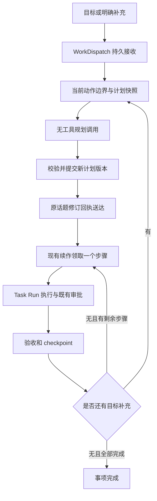

# HomeAgent Super-agent 演进方案

日期：2026-11-06（Asia/Shanghai）。

实施进度更新：M1 已完成实现和本轮功能验收，当前代码行为以 README / CONTEXT 为准；验证范围见 [M1 计划修订验收](../../research/2026-11-06-m1-plan-revision-verification.md)。下文保留原规划时的基线与 M1–M4 分期，M2–M4 尚未实施。

状态：规划稿；本次交付包含本轮开发收尾提交和本文，不包含下面 M1–M4 的实现。
已验收代码基线：`2e41364`。当前支持行为以 [README](../../../README.md)、[CONTEXT](../../../CONTEXT.md) 和源码为准。
本方案接续 [多事项协调方案](2026-11-03-homeagent-multitask-coordination-design.md)，不改变其中“一个群绑定一个 Agent、独立事项并行、同事项与同原生话题顺序执行”的产品约定。

## 1. 推荐路线与交付顺序

继续由 HomeAgent 管理目标、计划、执行、验收和知识，使用现有 Codex / Claude 等 Provider 执行。按以下顺序演进：

| 阶段 | 用户得到的能力 | 依赖与完成条件 |
| --- | --- | --- |
| M0：本轮收尾，已完成 | 聊天目标自动规划、逐步续作、原话题交付；Codex 收尾不再阻止完整结果提交 | 代码 `2e41364`，真实飞书两步流程完成；验证范围见第 2 节 |
| M1：可修订的顺序计划，下一轮开发 | 执行中补充“增加成本比较”“摘要改成 100 字”等要求，系统更新剩余步骤，保留已验收成果 | 稳定步骤 ID、计划版本、动作关联、消息驱动修订、工作台可查；通过第 8 节 M1 验收 |
| M2：遇阻重规划与完成反馈 | 根据实际阻塞选择已有授权范围内的替代步骤；缺少必要资料时明确等待；最终验收后聊天也收到完成状态 | 以 M1 的版本与证据为基础，不能用改写文本掩盖失败或重复执行外部操作 |
| M3：专业 Worker 与独立子事项协作 | 同一群 Agent 按任务调用研究、写作、编码、审查能力；明确独立的子事项可以并行，依赖满足后汇总 | 先做顺序委派，再做独立子事项依赖图；每个子事项内部仍顺序执行 |
| M4：DeepSeek Harness 研发试点，可选 | 在单仓库研发任务中比较 Harness 与现有执行方式的实际收益 | 有对应研发需求后开展知识接入和执行闭环试验；不作为 M1–M3 的依赖 |

**建议下一轮只实施 M1。** 它同时解决用户追加要求、计划跟不上实际进展、后续重规划缺乏可靠依据的问题。M1 完成后再以实际阻塞场景实施 M2，避免一次引入多套调度和恢复机制。

## 2. 当前已经具备的能力与剩余缺口

### 已完成且有证据的部分

- 同一个群绑定的同一个完全访问 Agent 可以处理多个独立事项；同事项、同原生话题保留顺序和已送达 parent 的约束。
- 新事项及尚无计划的已有事项可以从聊天目标生成有完成标准的顺序计划；普通问答和仅要方案保持原路径。
- 首步在规划回执送达后唤醒，后续沿既有调度周期推进；后一步读取已验收的完整前序成果。
- 完全访问 Task 沿用逐次执行审批和结果验收；只读动作仅在满足既有结构化验收条件时自动接受。
- 暂停、取消、重启恢复、失败回执重试和归档保持现有语义；运行中中断的进程不自动重放。
- Codex 完成协议与完整结果均就绪后，可以回收卡住的进程和输出管道，继续正常提交、验收及投递。

[本轮验收记录](../../research/2026-11-06-codex-completion-verification.md) 包含真实消息和 Run 标识：两步测试最终得到总数 20、完成率 60%、阻塞占比 15%，结果已读回原飞书话题，事项完成且未重复执行或投递。
Ubuntu 固定源码回归合计 2552 通过、10 跳过、0 失败；Windows 与 Ubuntu 类型检查、质量评测 14/14、Linux 崩溃恢复通过。跳过项、曾出现且已复跑解决的中间失败均保留在记录中。
macOS 实机、长时间 soak、签名、公证及发布门禁未在本轮验证，不能把这次功能验收称为全部发布就绪。

### 当前缺口及源码依据

| 缺口 | 当前实现 | 演进影响 |
| --- | --- | --- |
| 计划只能首次自动生成 | `applyChatPlan()` 不替换已经存在的计划 | 明确追加目标还不能形成可追踪的计划修订 |
| 步骤身份依赖文本 | `nextActions: string[]`；领取动作及验收投影比较首步 instruction | 修改文字容易与已冻结动作冲突，需要稳定 ID 和版本 |
| 阻塞后的路线调整未自动化 | `WorkAction` 记录 blocker，事项停止自动续作，已有重试/放弃入口 | 需要区分可替代方案、缺少输入和执行结果不确定 |
| 缺少受管 Worker 委派 | HomeAgent 调度 Chat / Task Run；Provider 内部 subagent 不等于 HomeAgent 管理的 Worker | 后续才增加可追踪委派，不把模型内部工具调用算作本层能力 |
| 最后验收后的聊天状态未补发 | Task 结束时发送“等待验收”；接受后工作台显示完成 | M2 补齐终态通知和幂等恢复 |

相关 Module：[工作计划生成](../../../packages/orchestrator/src/work-planning.ts)、[工作事项](../../../packages/core/src/work-items.ts)、[续作与验收](../../../packages/core/src/work-continuation.ts)、[Engine](../../../packages/core/src/engine.ts)、[续作调度](../../../packages/app/src/work-continuation-scheduler.ts)、[聊天结果通知](../../../packages/app/src/chat-work-notification.ts)。

## 3. 与 DeepSeek 公开架构的关系

2026-11-06 重新查询官方仓库分支：`dsh-superagent-prototype/main` 为 `8c32a9dc5d72c033816c6a8110b37f40cf94fba4`；`deepseek-harness/master` 为 `fcc0ad462172522aaf5c93a7b2e01f6b9f0b0159`。
下面的原型分析固定到前一个提交；Harness 仅核对分支，不据此宣称完成其适配验证。11 月 3 日研究使用的 `6337fc8` 是历史版本。

官方 README 将原型定位为面向单个 GitHub 仓库的研发助手，并说明它与文章描述并不完全相同，有些设计尚未实现。因此不能将文章中的全部能力视为可直接安装的成熟功能。[原型定位](https://github.com/deepseek-ai/dsh-superagent-prototype/blob/8c32a9dc5d72c033816c6a8110b37f40cf94fba4/README.md)

可以借鉴其接收事件、识别事项、独立执行、跟进输入和回传结果的职责划分。其 Engine、Executor、Outbox 有明确分工，适合映射到 HomeAgent 已有的 WorkDispatch、WorkItem、WorkAction / Run 和通知能力；这是本方案的工程选择，不是现成兼容协议。[官方架构](https://github.com/deepseek-ai/dsh-superagent-prototype/blob/8c32a9dc5d72c033816c6a8110b37f40cf94fba4/docs/007-architecture.md)

其 Worker 具有自身会话和执行目录，输入可以进入进行中的会话；中断恢复也有其专用语义。HomeAgent 当前的一次性 Provider 调用、Run 冻结和禁止自动重放运行中进程的契约需要单独适配，不能照搬原型的恢复行为。[执行与恢复](https://github.com/deepseek-ai/dsh-superagent-prototype/blob/8c32a9dc5d72c033816c6a8110b37f40cf94fba4/docs/003-execution.md)

本方案先吸收这些协调职责，保持一个 HomeAgent 事项与执行账本。是否接入 Harness，以及是否使用 DeepSeek 模型，是后续各自独立的实现选择。

## 4. M1 的用户行为

示例目标：“汇总项目进展，再生成周报”。第一步已验收，第二步执行前用户补充：“增加阻塞原因，摘要限制 100 字”。

系统应保留第一步的真实成果，将尚未执行的第二步修订为包含阻塞原因的短摘要，并记录修订来源。用户不需要复制事项 ID、重新建计划或手动回填已完成步骤。

| 到达时机或操作 | 预期行为 |
| --- | --- |
| 当前没有活动动作 | 读取目标、当前计划、已验收成果和这次补充，生成并保存新版本；原话题说明改了哪些步骤 |
| 当前动作运行中 | 持久接收补充并提示在当前动作结束后生效；不改正在运行的输入，不同时执行同事项第二个动作 |
| 当前动作待审批或已排队、尚未启动 | 如果补充改变这一步的执行内容，通过既有取消路径结束旧 Run，再为新步骤创建新 Run；已有批准不转移到新 Run |
| 当前动作等待结果验收 | 保留这次成果和原验收对象；补充先排队，在已有验收或驳回完成后处理，不静默接受或丢弃成果 |
| 最后一步验收时还有待处理的目标补充 | 先处理持久化补充，再判断整个事项是否完成，避免提前发送完成通知 |
| 用户只问进度或要求解释计划 | 读取已保存状态，不启动修订模型；“仅建议、不执行”不改变执行计划 |
| 用户手工修改剩余步骤 | 保留工作台编辑能力；有结构化计划的事项通过同一修订 Interface 保存，记录为人工变更 |
| 暂停期间补充目标 | 可以记录或修订计划，保持暂停；仅明确恢复操作使续作重新可调度 |
| 用户已关闭自动续作 | 修订不重新开启它；手动继续路径仍可使用 |
| 已完成事项收到明确新增工作要求 | 创建该事项的新计划版本并按既有明确操作恢复活动；“谢谢”等普通回复不恢复执行 |

正常、范围明确的计划修订不增加审批。执行阶段继续遵守已有 Task 审批与验收；模型提出超出用户目标的新工作时不自行扩张范围。

## 5. M1 的数据与执行设计

### 5.1 稳定步骤与版本

新增 Core `WorkPlan` Module，负责计划定义、版本提交、当前步骤解析和只读投影。它不负责 Provider 启动或消息传输。

| 概念 | 持久内容 | 规则 |
| --- | --- | --- |
| `WorkPlanRevision` | WorkItem / Space、版本、前一版本、目标、步骤定义、修订原因、来源 Run 引用、内容摘要 | 提交后不可改写；一次修订产生一个新版本 |
| `WorkPlanStep` | `stepId`、instruction、doneWhen；旧步骤的兼容标识 | M1 为有序列表；执行含义不变的步骤保留 ID，改变执行内容或完成标准则产生新 ID |
| `planRef` | 当前版本及其摘要 | 归 WorkItem 所有，与当前计划展示投影在同次原子保存中切换 |
| `WorkAction.planStep` | 领取时的版本、stepId、定义摘要 | 动作仍由 WorkAction / Task Run 管理；重试继续冻结旧动作和执行计划，不换用当前配置 |
| 已验收成果引用 | stepId 对应的 Action、Task Run、checkpoint、Raw 引用 | 执行和准入状态仍以现有验收记录为准，计划不能凭模型输出把步骤标为成功 |

计划修订针对剩余工作。已验收成果继续保留；若新目标需要重做某项成果，新增一个有明确理由的步骤，引用旧成果并说明适用范围，不撤销或覆盖旧验收。
失败、取消和被驳回的成果可以作为诊断上下文，但不能冒充 accepted 成果或进入知识引用。

`chatPlanRunId` 继续承担首次规划来源和原始结果投递定位，不随修订更换。新版本的来源 Run 独立记录，避免“修改计划”顺带改变结果应回复的位置；明确改变交付位置的用户指令单独沿现有投递规则处理。

### 5.2 存储所有权与兼容

以下均为 M1 拟实施的格式，当前提交仍是 WorkItems v2、WorkContinuation v1、Space archive v21：

- `config/work-plans/<workItemId>/revision_<n>.json`：不可变的计划定义，文件格式 v1。按版本分页读取；每份定义与既有计划规模一致，不把全部版本长期堆入一个数组。
- `config/work-items.json` v3：增加当前 `planRef`。有结构化计划时，`runbook` 和 `nextActions` 是同次提交生成的兼容展示投影；它们不能与计划定义各自独立演进。
- `config/work-continuation.json` v2：WorkAction 增加可选 `planStep`；Action、acceptance 和 checkpoint 的权威归属不变。
- Task Run 保持现有执行账本，通过其 `workActionId` 关联上述不可变步骤；不为步骤另建一套任务运行状态机。
- Space archive v22：携带计划定义、版本关系和动作关联；不导出本机输入、投递坐标、执行确认或 Provider Session ID。解析器、迁移、双向证据校验和兼容文档在同一开发批次更新。

采用不可变版本文件加当前引用，避免每次事项状态更新都重写全部计划历史；当前引用和展示投影仍由 WorkItemStore 一次原子提交。计划文件属于工作状态，不属于 Raw journal 或 Knowledge page，也不以 SQLite projection 作为唯一所有者。

旧数据保持可读。旧事项没有结构化计划时继续原路径；已有自动计划在需要修订且到达动作边界时转换剩余步骤，保留原文字。旧文本无法可靠分离完成标准时标记 legacy，不猜测或编造；新生成步骤仍必须给出完成标准。
已有运行中的旧动作按原冻结文本与验收关系完成，转换不能改变它的身份。手工 runbook 不强制改造成自动计划。

沿用现有每份计划最多 200 个步骤、步骤文本边界、200,000 字符 runbook 及现有引用约束；修订历史按独立有界文件和分页读取保存，不新增总修订次数或模型调用时限上限。
导入导出继续使用既有大小检查，不能静默丢版本、截断成果引用或丢失尚被 Action 引用的定义。

### 5.3 小 Interface 与提交过程

Core 对 Orchestrator / Web 暴露的拟议 Interface 只有三项职责，名称在实现时与现有公开导出保持一致：

1. `prepareWorkPlanRevision`：解析同事项来源输入，取得当前版本、已验收成果、活动动作状态及输入游标，生成不可变的规划快照与一致性摘要。
2. `commitWorkPlanRevision`：校验模型结果及归属，比较准备时的版本、动作和输入状态，原子切换当前计划及兼容投影；同一来源重复提交返回原结果。
3. `getWorkPlanView`：返回当前步骤、版本差异和实际动作状态；不触发模型，也不修复或改写持久状态。

`startWorkContinuationAsync()`、审批、验收、重试、取消和通知继续使用现有 Interface。`WorkPlan` 的持久实现隐藏在 Core 内，App 组装调度，Web 不读取计划文件。
规划函数扩展现有 `generateWorkPlan()` 的输入与校验，不新增常驻 Supervisor 进程、通用事件总线或动态插件框架。

提交顺序：

1. 沿现有 WorkDispatch 持久接收补充；只有执行目标变更才进入修订。该次 Chat Run 冻结规划指令、模型和限制，调用保持无工具、无话题历史。
2. 到达允许修订的动作边界后准备快照。模型期间若用户取消、修改计划、处理验收或输入状态改变，迟到结果不能覆盖更新状态。
3. 先验证新定义及全部引用，再将完整 revision 写入同目录临时文件、fsync、原子更名。文件存在但尚未被 `planRef` 指向时，不具备执行效力。
4. 在同步临界区再次核对快照，通过 WorkItemStore 原子保存 `planRef`、兼容投影和变更标记。这是计划切换点；失败时旧版本继续有效。
5. 沿既有 Chat Run 投递路径回复修订摘要。新版本步骤在修订回执确认送达后才参与自动领取；本机投递门禁不从 Space 归档历史补造。
6. 领取动作时冻结 stepId 和版本，验收投影按身份核对，不能再仅凭文字相等消费当前首步。Action 的验收提交先于 WorkItem 投影，恢复可幂等补投影，不能重跑动作。

收到重复消息、修订回执重试或规划结果提交失败后的重试，均复用同一次修订身份；不会再生成一套步骤。发生版本冲突时重新读取最新状态处理剩余输入，不自动把旧补充标成已完成。
首次规划也切到同一计划提交路径；保留当前已经验收的首次规划、回执、暂停和恢复行为。

### 5.4 代码落点与可独立验收的提交

| 提交批次 | 主要落点 | 完成标准 |
| --- | --- | --- |
| M1.1 计划定义与兼容读取 | 新增 Core `work-plans.ts` 及同目录测试；扩展 `work-items.ts` | 稳定 ID、版本校验、深拷贝、原子保存、坏数据拒绝和旧数据读取通过；先保持执行行为不变 |
| M1.2 动作身份与验收投影 | `work-continuation.ts`、`engine.ts` | 新步骤按身份领取/验收，旧动作仍按原路径完成；审批和冻结配置不变 |
| M1.3 修订与恢复 | `work-planning.ts`、`runtime.ts`、`work-dispatch.ts`、App 续作调度 | 用户补充在动作边界生成新版本；重复事件、取消、存储失败、回执失败和重启均不重做已完成步骤 |
| M1.4 工作台与归档 | `packages/web/src/app.ts`、`views.ts`、Core `governance.ts` | 可看当前步骤和修改原因，手工编辑保留；v22 归档及 v1–v21 兼容测试通过 |
| M1.5 文档与整体验收 | README、CONTEXT、beta runbook、集成测试 | 第 8 节全部适用门禁完成；真实复测记录哪些已执行、哪些尚未验证 |

这些批次在开发分支上依次完成；不将存储格式已变但验收/归档尚未兼容的中间提交部署到运行服务。

## 6. M2：事件驱动的遇阻重规划

M2 在 M1 之后新增由实际动作结果驱动的规划请求。它属于计划管理，不是另一个有任意执行权限的监督 Agent。
每次请求保存触发 Action / attempt、计划版本、阻塞事实、冻结规划输入及处理结果；相同事实只处理一次。使用既有中央 AI 限制，不通过缩短模型超时控制循环。

| 事件 | 后续动作 |
| --- | --- |
| 用户提供了缺失资料或明确修改要求 | 复用 M1，基于新输入修订剩余工作 |
| 某来源不可读，但目标范围内存在已知替代资料 | 可生成替代查询步骤，说明来源变化；按该步骤实际冻结权限执行 |
| 需要的数据、账号或决定确实缺失 | 持久保存一个具体问题与阻塞条件，回复原话题；新信息到达前不循环请求模型 |
| Provider 启动/执行失败或进程中断 | 保留失败事实；沿已有显式重试语义处理，不借“重规划”自动重放原动作 |
| 外部写入的结果不确定 | 先使用该系统实际查询能力核对；不能证明效果时保持不确定状态，不再次提交同一副作用 |
| 人工驳回成果 | 保留 excluded 证据；根据驳回原因提出新的改正步骤，不把失败改写成成功 |
| 计划全部通过验收 | 持久产生该计划版本的完成通知，原话题只投递一次 |

自动修订仍然必须在原目标与实际授权范围内；write/full 新 Run 需要它自己的既有审批。计划生成无需另加“计划批准”步骤。
未改变目标、证据或阻塞条件的重复通知不能产生新的规划调用；新事实到达、原有重试操作或用户要求重新考虑才再次评估。用事实变化防止空转，不设置拍脑袋的总重试次数。

完成通知在最后一次验收及事项完成持久化后生成，复用现有通知发送和重试机制；键包含事项、计划版本、通知类别。
“已执行待验收”“已验收完成”“遇到阻塞”在聊天和工作台保持一致，恢复与重复回调不重复通知；投递失败不重新运行工作。
涉及自动事件的准备记录及恢复契约需在 M2 实施前补齐字段设计；M1 不为尚未接入的事件源预建队列。

### 6.1 M2 字段与提交顺序

本机 `config/work-events/` 使用独立原子文件。`recovery_<sha256>.json` v1 保存 `workItemId/space/sourceInputId/actionId/attempt/runId/factKey`，冻结 `prepared`（目标、计划引用、剩余步骤、已验收成果、fingerprint）和 `planner`（Agent revision、Provider/model/reasoning、指令、中央时限与输出限制），以及结构化报告、驳回原因、状态和决策。事件不能携带执行工具权限或 Provider 会话。

`queued → running → decided → applied/waiting`；失败为 `failed`，快照过期为 `obsolete`。重启保留 queued 与 decided，running 转 failed；保存决策后才提交新计划。WorkItem 同次提交新引用和该触发动作的阻塞移除，再取消旧 Action；若取消写入失败，恢复通过新计划及步骤身份补齐，不能重跑动作。新计划使用定义 v2 的 recovery 来源（事件 ID、Action ID），旧 v1 文件摘要保持不变。

`notice_<sha256>.json` v1 保存来源输入、计划引用、completion/replanned/waiting 类别、冻结正文、尝试时间和远端 receipt。验收前先登记 completion watch，全部验收后转 pending；已经完成的旧事项不补发历史通知。修订回执送达才放行续作；投递失败沿用 Task 通知退避间隔，进程内保留已知远端 receipt，重启使用同一幂等键。完成键包含事项、计划版本与类别。

Space archive v23 携带已提交计划和触发 Action 的可移植历史，严格验证 recovery 关联；兼容 v1–v22，不导出本机事件或通知权限。WorkItems v3、WorkContinuation v2、WorkDispatch v1 保持格式不变。

## 7. M3 实施范围与 M4 试点

### M3：专业能力委派与独立子事项依赖

先增加按步骤选择已发布 Agent revision 的委派，冻结 Provider、模型、Skill、权限和 Workdir。默认继续使用群绑定的 Agent；只有配置了适用的 Worker 才使用相应执行配置，不能静默扩大 Space 或执行权限。
群仍绑定一个面向用户的 Agent，负责协调与交付；不要求为每个 Worker 建群或添加机器人。Worker 是 HomeAgent 的执行职责，其配置复用已有 Agent，不复制一套身份和权限系统。

随后支持用户明确要求分开推进的独立子事项，例如“分别调研 A、B，再做对比”：

- A、B 作为同 Space 下有明确父目标的独立 WorkItem；各自仍最多一个活动 WorkAction，使用现有全局及 Provider/model 并发额度。
- 父计划记录子事项依赖；汇总步骤只消费依赖项已验收的成果，不使用 held / excluded 证据。跨 Space 不隐式汇总。
- 同一目标内有前后依赖的步骤继续顺序执行；不因存在多个 Worker 就将同一事项的写操作并发化。
- 工作台显示父目标、各子事项和依赖。父目标取消需持久记录受影响的子事项，再使用既有取消路径；共享或独立创建的其他事项不能被误取消。
- 子事项执行使用各自 Task Run；不会并发推进同一个飞书 Provider-native 会话链，协调回复继续保持原话题顺序。
- 对同一仓库分支、文件或外部对象存在实际冲突的写入，使用计划依赖排序；研发任务确需独立工作目录时再复用 worktree 等现成能力，不给所有工作默认增加隔离层。

Worker 审查可以贡献检查结果，不能替代现有需要人工验收的动作。先以“调研→撰写→检查”顺序链验证角色委派，再验证“两项独立调研→汇总”，不同时上线任意 Agent 间对话网络。

#### M3 实现契约（2026-11-06）

- 规划器接收当前 Space 可用的已发布专业 Agent；每步可指定 `agentId`，未指定继续使用协调 Agent。委派不超过协调 Agent 的权限，完全访问 Worker 复用自身有效的本机 Task 执行确认。
- 计划定义 v3 的 `workers` 保存 Agent 发布快照与 revision，`step.worker` 引用固定版本；执行时冻结 Provider、模型、Skill、权限和 Workdir，审批/验收继续由已有 Task Run/WorkAction 管理。旧计划 v1/v2 摘要保持不变。
- `children` 输入将独立业务目标拆为同 Space WorkItem，父计划持久引用初始子计划。子定义先落盘，父计划引用及子事项在 WorkItems v4 一次提交；默认事项仍为父目标。`dependsOn` 存储稳定事项 ID，包含父完成依赖的整张图必须无环。
- 子事项按原有额度并行，各自内部顺序。父目标回执未送达、暂停、关闭续作或有待处理补充时，不领取新子步骤。依赖完成且验收通过后才构造汇总 Task，其输入仅含各依赖最后已验收成果和证据引用。
- WorkItems v4 读取 v1–v3；Space archive v24 读取 v1–v23，携带发布快照和父子/依赖历史，不携带本机授权、取消队列、投递来源及事件。遇阻事件 v2 读取 v1，保留委派/依赖上下文；通知仍为 v1。
- 父目标取消先保存所属子事项 ID，再复用取消路径；重启补齐取消，不取消仅作为依赖引用的独立事项。子事项消息使用父目标原话题，Task 不推进同一个 Provider-native Chat 会话链。只有父目标登记最终完成通知。
- M1/M2 继续适用于每个子事项。原话题明确指出子事项的补充路由至该事项；只有一个子事项等待缺失事实时，直接补充即可继续。父目标状态查询包含子事项状态。

验收分别记录本地替身流程、Ubuntu 回归和真实飞书；平台、迁移、签名、公证及 soak 不因功能测试通过而自动通过。

M3 的实现、真实测试中发现的修复及最终验收证据见 [M3 委派与协作验收记录](../../research/2026-11-06-m3-agent-delegation-verification.md)。

### M4：可选 Harness 研发试点

首个候选场景是单仓库“问题反馈→复现→修复→测试证据/PR→评审补充”。先验证 HomeAgent 知识查询，再验证一个受管动作的执行和结果回传。知识查询成功不代表完成了任务接入。

原型管理 Interface 提供查询、重试和停止等操作，目前核对的类型中没有通用创建 Ticket 入口；不能假定存在 `POST /tickets`。[管理 Interface](https://github.com/deepseek-ai/dsh-superagent-prototype/blob/8c32a9dc5d72c033816c6a8110b37f40cf94fba4/src/app/api.ts)
其 Cookbook 给出 Source 扩展路线，Executor 另有 start/deliver/stop 职责。若采用原型作为外置研发执行实现，需要实际编写并验证 Adapter。[Source 扩展](https://github.com/deepseek-ai/dsh-superagent-prototype/blob/8c32a9dc5d72c033816c6a8110b37f40cf94fba4/docs/008-cookbook.md)、[Executor Interface](https://github.com/deepseek-ai/dsh-superagent-prototype/blob/8c32a9dc5d72c033816c6a8110b37f40cf94fba4/src/core/ports.ts)

试点必须证明以下交付契约，再决定是否进入主路径：

1. HomeAgent WorkAction / Task Run 与外部 Ticket / Assignment 有稳定映射，HomeAgent 继续拥有最终验收和知识准入。
2. 冻结执行配置、Skills、取消、重复输入、结果回传、未知投递状态和双方重启可对账；外部恢复不能自动重放 HomeAgent 已标为中断的动作。
3. 原型不能同时独立监听同一批用户请求并重复创建工作；结果通过映射回到原事项，不由两层分别宣布完成。
4. 与当前 Provider 在同类任务上比较验收成功率、用户补充次数、耗时、模型用量、重复副作用和维护成本，再决定保留哪一种执行路径。

本轮没有安装 Harness、调用真实新 Provider、下载运行原型或验证其 Windows 部署。实际选版本、平台和配置在试点时核对；不提前把外部依赖写进主服务启动链。

## 8. 验收、观察与上线

### M1 必过的行为矩阵

| 场景 | 可核对的结果 |
| --- | --- |
| 已完成第一步后更改摘要要求 | 同一事项产生新版本；已验收 Run 不变、执行次数不增加；新结果符合新要求 |
| 同时补充两条要求 | 来源顺序可追踪，无丢失；过期规划结果不能覆盖较新的计划 |
| 两个步骤文字相同、身份不同 | 分别执行和验收，不能错误去重或消费另一步 |
| 运行中补充、暂停、取消 | 接收与工作台不被 Provider 阻塞；迟到结果不重新激活取消事项，同事项不重叠执行 |
| 待审批、待验收时改计划 | 旧 Run 的批准不转移；待验收成果可正常处理；既有审批和验收入口仍可用 |
| revision 保存后指针提交失败 | 旧版本仍有效，孤立文件不参与执行；恢复不重复创建动作 |
| 指针切换后回执失败或服务重启 | 复用已保存版本完成回执；未确认送达前不执行新步骤，不重复模型规划 |
| 验收提交后 WorkItem 投影失败 | 重启补齐投影一次；已完成动作不再执行，Raw 准入与 checkpoint 一致 |
| 用户关闭续作或暂停后重启 | 保留选择；修订和历史恢复不能重新打开 |
| 历史裁剪、备份导入导出 | 保留动作使用的计划定义；不丢原投递语义、不恢复本机权限；旧归档继续可读 |
| 原有正常路径 | 首次自动规划、手工 runbook、单步 Chat、学习、提醒、定时 Task、指定查询群与交付位置均不收窄 |
| 一个完全访问群 Agent 处理两个事项 | 独立事项仍能重叠执行，各自审批/验收有效；同原生话题 fork 与送达顺序正确 |

测试通过 Module 的公开 Interface 验证行为与故障窗口，使用假 Provider / transport 和隔离临时目录，不直接编辑线上数据。
新增 `work-plans.test.ts` 与实现同目录；扩展现有 WorkItem、WorkAction、Chat 规划、恢复、归档和 Web 测试。

实施期间运行最窄相关测试，交付前运行 `bun run typecheck`、Ubuntu/macOS `bun test`、`bun run evaluate:quality`、`bun run verify:crash-recovery`。
真实 Feishu / Provider 验收按该轮明确授权及 `HOMEAGENT_LIVE=1` 执行。发布门禁仍以 [beta runbook](../../beta-release-runbook.md) 为准，不将 Windows 聚焦测试替代 macOS 实机或发布验证。

### 观察指标

分别记录接收、规划、排队、Provider 启动/执行/收尾、等待人处理、验收、通知送达各段耗时，避免把等待审批时间算成模型启动延迟。
工作台从已保存状态返回；先记录本机和支持平台基线，再比较相同负载下的分布，不承诺未经压测的延迟数字。
关注计划修订正确率、已验收步骤误重做次数、重复投递次数、明确阻塞后无新事实的规划调用次数，以及每个完成事项的模型用量。
正确性验收要求已验收步骤误重做、重复投递和无新事实空转次数为零；质量与成本比较使用实际场景数据，不预设节省比例。

### 上线与回退

M1 存储、执行、归档和恢复同时兼容后，再在现有测试场景上启用。部署前通过正常流程保存完整备份；迁移先验证并写好新版本所需定义，再切换引用，不删除旧数据。
如果修订策略有问题，可以关闭自动修订并保留顺序执行、手工编辑和现有续作；这是上线回退措施，不是功能完成标准。
已产生 v3/v2/v22 数据后，旧二进制不能直接作为无损回退方案。优先使用能读取新格式的修复版本；升级前备份用于隔离恢复核对，不覆盖升级后已发生的操作和验收记录。
任何计划回退都创建新版本，只调整未来工作；不能回滚外部效果或抹掉已验收证据。

## 9. 本次规划完成标准

本轮功能与修复已经提交，验证证据可追溯；下一轮的 M1 范围、数据所有权、提交顺序、兼容策略、测试场景和完成条件已明确。
M2–M4 保留各自目标和依赖，尚需在进入对应阶段时细化新增事件记录、Worker 委派及外部 Adapter 的字段与验证方案，不将它们报告为已实现。
后续开发从 M1.1 开始，完成整个 M1 后再交付一次真实“执行途中补充要求→修订剩余计划→验收→原话题交付”的闭环。
